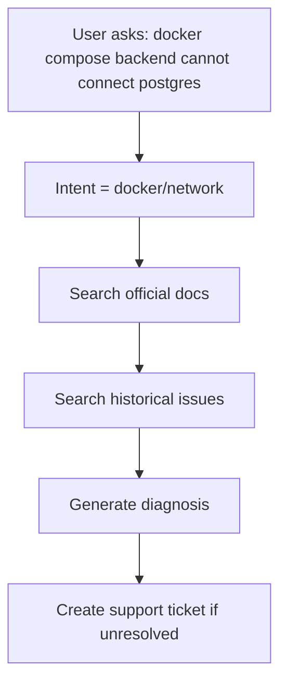

# Week 1 业务流程

用户提问：`docker compose backend cannot connect postgres`

1. 用户提出问题：backend 容器连不上 Postgres。
2. 识别意图为 `docker/network`，后面的检索都按这个意图缩小范围。
3. 先查官方文档。这类来源的类型是 `OFFICIAL_DOC`。
4. 再查历史 Issue。这类来源的类型是 `GITHUB_ISSUE`，和官方文档分开存放。
5. 根据查到的材料生成诊断。
6. 诊断仍不能解决问题时，创建一条支持工单 `Ticket`。
